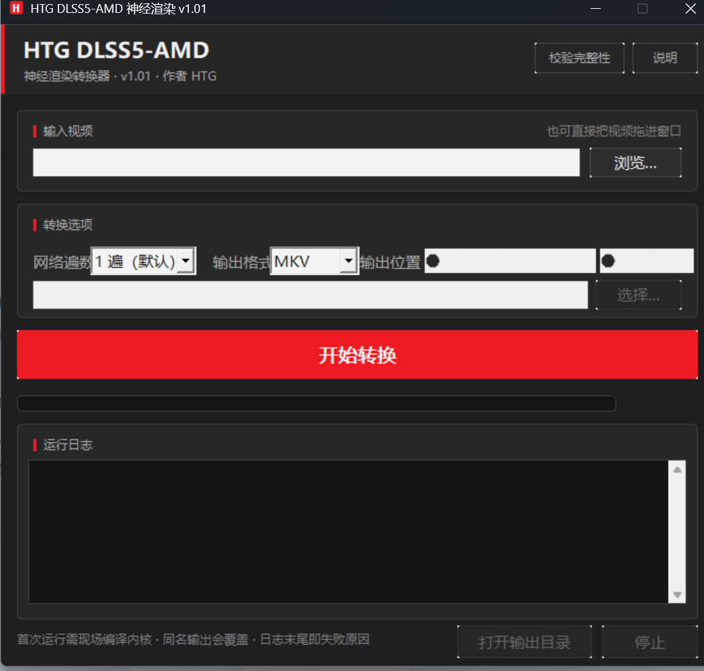

# DLSS5 on Video on AMD

**把视频送进 NVIDIA 的 DLSS 神经渲染器，在 AMD 显卡上跑。**

本项目基于 [DLSS Video Player v0.28.3](https://github.com/2600th/dlss5-video-player)（MIT），在其上增加了 AMD 神经渲染后端和一个原生 Win32 图形界面。上游的 `NeuralWorker` 走 NVIDIA NGX，在 AMD 上会直接报 `Feature 18 was not created`；本项目把它换成读写 AMD 神经渲染资产（Mochizuki NR + RenoDX DLSS5）的实现，从而让整条离线渲染链在 A 卡上跑通。

> *Run NVIDIA's DLSS 5 neural renderer over video files on AMD GPUs.*



---

## 下载

到 [Releases](../../releases) 页面取最新包：

```
HTG-DLSS5-AMD-v1.01-win64.7z     349 MiB（解压后 812 MiB）
SHA-256: 7144D875B12C2D861213B46DD5472E9A7A31CFBC4384226CAB387C7160127D63
```

**不要只下载单个文件**，必须解压整个目录。`HTG-DLSS5-AMD.exe` 只是个壳，真正的引擎在 `engine\` 下，缺了它启动就会报"找不到 dlss5-convert.exe"。

## 系统要求

| 项 | 要求 |
|---|---|
| 系统 | Windows 10 / 11 x64 |
| 显卡 | AMD，建议 RDNA2 及以上（Vulkan 神经渲染需要足够显存） |
| 显存 | 1080p 建议 6 GB 以上，4K 建议 12 GB 以上 |
| 磁盘 | 解压后 812 MiB，另需输出文件的空间 |

## 用法

1. 解压整个目录到任意位置（路径可以含中文）
2. 双击 `HTG-DLSS5-AMD.exe`
3. 选输入视频 → 选输出位置 → 点「开始转换」
4. 输出默认是同目录下的 `原名-nr.mkv`

也可以命令行批处理：双击 `一键转换.cmd`，或直接调用引擎：

```bat
engine\dlss5-convert.exe --input in.mp4 --out out.mkv
```

## 完整性校验

本包**未做代码签名**，SHA-256 是唯一的完整性凭据。

```
双击 校验完整性.cmd
```

会逐一比对 919 个文件的 SHA-256，末尾打印 `checked 919 files, 0 problem(s)` 即完好。

> 跑过一次转换后，`engine\neural-runtime\ReShade.ini` 会被运行时重写（写回本机缓存路径和窗口状态），`engine\` 下也会多出若干 `.log` 和 `cache\`。这是正常运行痕迹，不是包坏了——想恢复全通过，删掉这些文件即可。

## 出问题怎么查

诊断日志：`%TEMP%\HTG-DLSS5-AMD-gui.log`

里面记录了程序目录、引擎目录、转换器与运行时资产是否存在、每次转换的输入/输出路径、启动命令行、进程 PID 和退出码。启动失败、找不到引擎、点了开始没反应——先看这个文件，比猜快得多。

## 仓库内容

```
src/        上游 v0.28.3 源码 + AMD 后端改动（AmdNrAbi.h、AmdNrBackend.*）
gui/        图形界面源码（htg_gui.cpp，原生 Win32，无第三方框架）
dist/       分发包用的用户脚本：一键转换.cmd、校验完整性.*、gen_hashes.ps1
packaging/  打包素材：runtime-lock.json、ReShade 配置、运行时通知
docs/       上游文档与测量记录
tests/      上游测试
```

**运行时二进制不在本仓库**：`engine/` 下有 4 个文件超过 GitHub 的 100 MB 单文件上限（`ffmpeg.exe`、`ffprobe.exe`、`nvngx_dlssnr.dll`、`dlssnr.bin`），所以二进制只作为 Release 附件分发。

## 构建

### 图形界面

需要 MSVC 与 Windows SDK，`build.bat` 里的路径按本机 VS 安装改：

```bat
cd gui
build.bat
```

### 引擎

见 [README.upstream.md](README.upstream.md) 与 [docs/BUILDING.md](docs/BUILDING.md)。上游用 CMake：

```bat
cmake --preset release
cmake --build --preset release
```

AMD 后端改动涉及的编译单元见 `CHANGELOG.md`。

## 关于运行时与权重

本包内含 NVIDIA 的神经渲染运行时（`nvngx_dlss.dll`、`nvngx_dlssnr.dll`）以及从其中抽取的权重（`engine\amd-nr-assets\`）。

- `nvngx_dlssnr.dll` 是社区修改版（ShortFuse 310.8.SF-v2），**去掉了 NVIDIA 的嵌入式签名**，并把 310.8.0 扩展到 Turing/Ampere/Ada/Blackwell。这属于实验性运行时，见 `EXPERIMENTAL_RUNTIME_NOTICE.txt`。
- 权重**不属于 MIT 授权范围**。它们是让 AMD 后端跑起来的数据，随包分发是为了开箱即用，但**不要单独抽取、再分发或商用**。
- 这些组件是 NVIDIA 的专有材料。本项目不对其授权状态作任何主张；如需合规使用，请自行取得 NVIDIA 的授权。

本仓库自己写的代码（GUI、AMD 后端桥接、打包脚本）以 MIT 发布，见 `NOTICE.md`。

## 致谢

- [2600th/dlss5-video-player](https://github.com/2600th/dlss5-video-player) — 上游播放器与转换器（MIT）
- [RenoDX](https://github.com/clshortfuse/renodx) — DLSS5 addon
- Mochizuki / lmxxf / danielblnc — AMD 神经渲染实现
- ReShade、Streamline、RIFE ncnn Vulkan 等，完整清单见 `THIRD_PARTY.md`

## 许可

上游部分 MIT（`LICENSE`），本项目新增部分 MIT（`NOTICE.md`）。
NVIDIA 运行时与权重的授权状态不由此仓库的许可决定。
